- [FOREWORD](#FOREWORD)
- [PART 1 - THE CRAFT](#PART-1---THE-CRAFT)
  - [1.a - What is a desktop?](#1a---What-is-a-desktop)
  - [1.b - Desktop-crafting as an artform](#1b---Desktop-crafting-as-an-artform)
  - [1.c - The difference between customisation and design](#1c---The-difference-between-customisation-and-design)
  - [1.d - Coherence and restraint](#1d---Coherence-and-restraint)
- [PART 2 - THE FOUNDATION](#PART-2---THE-FOUNDATION)
  - [2.a - Design intentions and requirements](#2a---Design-intentions-and-requirements)
  - [2.b - Technology stack](#2b---Technology-stack)
  - [2.c - Distribution](#2c---Distribution)
  - [2.d - Compositor](#2d---Compositor)
  - [2.e - Desktop capabilities and components](#2e---Desktop-capabilities-and-components)
    - [Display management](#Display-management)
    - [Panel](#Panel)
    - [Backgrounds](#Backgrounds)
    - [Decorations](#Decorations)
    - [Application management](#Application-management)
    - [Menus](#Menus)
    - [Launchers](#Launchers)
    - [Notifications](#Notifications)
- [PART 3 - THE DESKTOP TAKES SHAPE](#PART-3---THE-DESKTOP-TAKES-SHAPE)
  - [3.a - Substrate](#3a---Substrate)
  - [3.b - Base dependencies](#3b---Base-dependencies)
  - [3.c - Desktop One](#3c---Desktop-One)
    - [Palette](#Palette)
    - [Initial steps](#Initial-steps)
    - [Themes and fonts](#Themes-and-fonts)
      - [Qt Theme](#Qt-Theme)
      - [Gtk Theme](#Gtk-Theme)
      - [Compositor Theme](#Compositor-Theme)
    - [Panel](#Panel)
    - [Wallpaper](#Wallpaper)
  - [3.d - Desktop Two](#3d---Desktop-Two)
    - [Palette](#Palette)
- [PART 4 - THE ENGINEERING](#PART-4---THE-ENGINEERING)

# FOREWORD

A computer desktop is an unusual kind of artefact. It is something that many
people use every day, often for hours at a time, yet rarely consider as a thing
in its own right.

Some might think of desktops in terms of the software that they consist of,
like window managers, panels, menus, launchers and applications. Yet the
desktop is more than the sum of these parts. It is an environment that has been
designed, assembled and shaped to provide a particular experience.

Building a desktop is therefore both a design activity and an engineering
exercise. It involves questions of aesthetics, usability and personal taste,
alongside questions of architecture, integration and technical implementation.

This book explores both sides of that activity.

# PART 1 - THE CRAFT

This section discusses the craft of desktop building in a technology agnostic
way.

## 1.a - What is a desktop?

A desktop is the interactive environment through which a person engages with
and makes use of a computer. It brings together visual presentation,
interaction mechanisms, applications, tools and services to provide a coherent
and usable working environment.

A desktop is not necessarily a single application or software package. It is an
assembled system whose constituent parts collectively provide the environment
in which a person works.

The desktop is the experience that the user encounters, rather than simply the
software that implements it.

This distinction is important. A desktop may depend on applications and
services that it neither owns nor implements. Its coherence comes from how
these elements are brought together, how they interact and how they are
presented to the user.

## 1.b - Desktop-crafting as an artform

A desktop is something that is crafted. It is designed and assembled, its
behaviour is shaped, its shortcomings are observed and it is refined over time.
The end result is not just a collection of software packages, but an
environment and place.

Desktop design is also an art. There are questions of taste, proportion,
rhythm, consistency and character that cannot be resolved through functional
requirements alone.

There is no single correct desktop. There are, however, better and worse ways
of realising a particular design intention.

## 1.c - The difference between customisation and design

Customisation changes how individual components look or behave. Design
considers the experience created by those components collectively.

A desktop can be extensively customised without being particularly well
designed. Changing colours, installing a different panel or replacing a menu
does not necessarily produce a coherent result.

Design begins with intent. What should the desktop feel like? How much
information should it present? How should it direct or avoid directing
attention? Should it be calm, busy, playful, austere or utilitarian? How should
it respond to the user's actions?

A desktop has a visual identity. Its components should look as though they
belong together.

It is therefore useful to establish a visual language relatively early, rather
than treating appearance as something to address after functionality is
complete.

This might consider:

- Fonts
- Colour palette
- Spacing and alignment rules
- Iconography
- Window decoration
- Panel dimensions and positioning
- Surface shapes, borders and shadows
- Interaction states, including hover, focus, active and disabled
- Animation principles

These are not independent styling decisions. They form a set of relationships
that should be applied consistently.

For example, a panel, menu, notification and settings window should not
independently invent their own spacing, corner radii, typography and colours.

The objective is not uniformity for its own sake, but a recognisable and
coherent visual language.

## 1.d - Coherence and restraint

The desktop is the experience the user actually encounters. Its quality is
determined not by the merits of individual components, but by how well they
work together.

A desktop does not improve simply because another feature has been added. Every
component creates relationships, dependencies and potential inconsistencies.
Each addition also introduces something that must be maintained, understood and
integrated into the overall experience.

This does not mean that minimalism is an objective. Sometimes there is beauty
in simplicity, and sometimes a more elaborate solution is appropriate. What
matters is that the choices are deliberate and that the resulting desktop has a
recognisable character.

There is also an important distinction between the expression of taste and the
imposition of taste. A desktop can be an expression of personal preference,
while the software components that support it need not impose their authors'
preferences on everyone else.

Coherence is not achieved by making everything identical. It comes from
establishing appropriate relationships between the parts, and ensuring that
they collectively serve the intended experience.

# PART 2 - THE FOUNDATION

This section evaluates design options and begins to down-select technology.

## 2.a - Design intentions and requirements

## 2.b - Technology stack

## 2.c - Distribution

## 2.d - Compositor

The compositor is a central component of a Wayland desktop. It manages the
presentation of surfaces, window positioning, focus and user interaction.

Some compositors are developed as part of comprehensive desktop environments.
GNOME and KDE, for example, provide largely integrated desktop experiences with
their own conventions, applications and supporting infrastructure.

In this book, labwc is used as the foundation.

Labwc is a stacking Wayland compositor inspired by Openbox. It is deliberately
focused on window management and does not attempt to provide a complete desktop
environment. This makes it particularly useful for exploring desktop
construction.

## 2.e - Desktop capabilities and components

### Display management

<!-- Outputs, resolution, scaling -->

### Panel

### Backgrounds

### Decorations

### Application management

<!-- Launching, identification, tracking -->

### Menus

### Launchers

### Notifications

# PART 3 - THE DESKTOP TAKES SHAPE

In this section, several desktops are built to explore the craft in practice.
They are kept simple and avoid implementing all the capabilities and design
considerations identified in parts 1 and 2 of this book.

## 3.a - Substrate

A bare-bones Arch Linux installation with labwc will be used as the starting
point for constructing the desktops in this book.

The choice of distribution is largely incidental to the design principles being
explored. Arch Linux is used here because it provides a relatively
straightforward way to establish a minimal system and install only the
components needed.

The installation was created using `archinstall` from the Arch Linux
installation image, selecting the labwc profile.

At this point, very few additional packages have been explicitly installed. The
system provides a functioning graphical session, a compositor and the ability
to launch applications, but little in the way of a complete desktop experience.

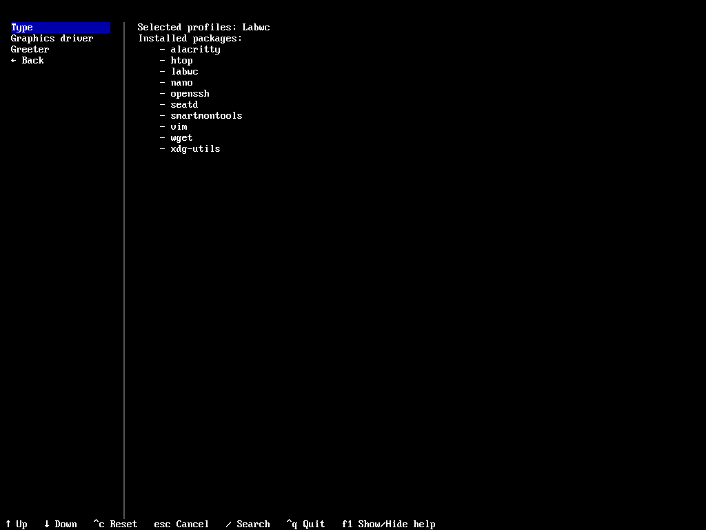

The following package list illustrates the starting point.

```
alacritty base grub htop labwc lightdm-gtk-greeter mesa nano seatd sudo vim
wget xdg-utils
```

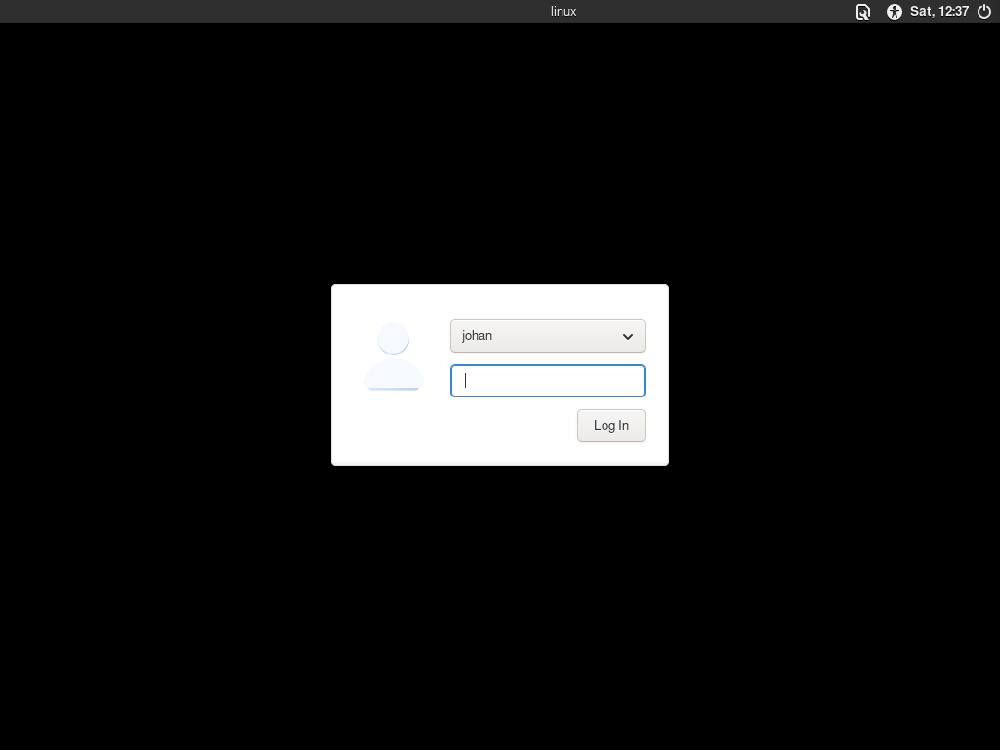

This is enough to get a compositor fired up and run programs, but it does not
provide much of a desktop. Running `free -h` shows that a mere 408 MiB of
harddisk space is used.

This starting point should be easy to achieve on many distributions by simply
installing `labwc` from their repositories and choosing it in the Display
Manager (graphical login program). However, at this stage there is not a lot
that meets the eye other than a blank canvas for construction.

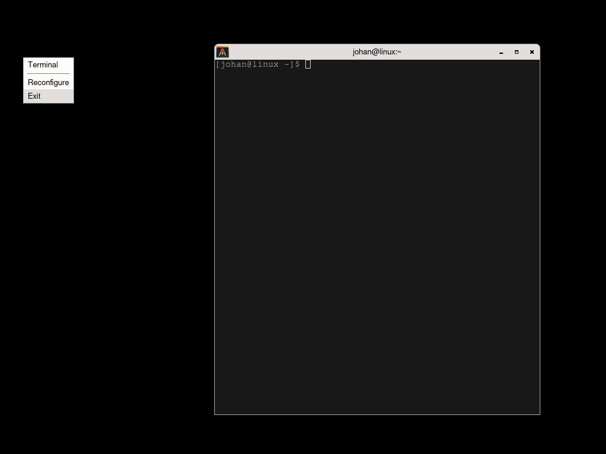

## 3.b - Base dependencies

A few more base package are needed to create a very simple desktop. The
instructions in "Desktop One" assume that the ones listed below have been
installed.

[bin/install-arch-linux-packages.sh](bin/install-arch-linux-packages.sh)

```
  labwc-themes
  labwc-tweaks
  labwc-menu-generator

  swaybg
  swaylock
  swayidle
  foot
  wtype
  wlr-randr            # manage outputs (monitors)
  slurp
  grim                 # take screenshots
  wf-recorder
  wl-clipboard

  rofi                 # application launcher
  mc

  kvantum              # set Qt theme
  qt6ct                # set Qt theme

  ttf-dejavu
  papirus-icon-theme   # Papirus icons
  gnome-themes-extra   # Neede to enable Adwaita-dark

  git
  man
  gcc
  pkg-config
  gnome-keyring
  bash-completion

  lximage-qt           # LXQt image viewer
  featherpad           # LXQt text editor
  pcmanfm-qt           # LXQt file manager

  gnome-text-editor    # Gtk4 test client
  mousepad             # Gtk3 test client
  thunar               # Gtk3 test client
```

## 3.c - Desktop One

To start with a simple but usable desktop will be created. It will note have
all the conveniences that may eventually be wanted, nor will it be particularly
sophisticated. The intention is to establish a foundation: something that can
launch applications, provide a consistent appearance and be used for ordinary
work.

This initial desktop will be built with static configuration files without any
supporting scripts. Also, settings will be hard-coded with no attempt to set
desktop-wide variables in one place. This is a conscious approach to keep the
setup as simple as possible to help the reader understand the construct.

### Palette

The palette is deliberately restrained, using a small number of closely related
dark greys, with white and mid-grey for contrast. It draws inspiration from
Adwaita-Dark and KvGnomeDark, which will be examined later. The same palette is
reflected in the labTeallach compositor theme.

      

| color     | purpose                |
| --------- | ---------------------- |
| `#282828` | Main background        |
| `#2e2e2e` | Secondary background   |
| `#303030` | Surface                |
| `#353535` | Raised surface         |
| `#505050` | Borders and separators |
| `#909090` | Secondary text         |
| `#ffffff` | Primary text           |

### Initial steps

Before doing anything else, a way to launch applications is needed. A root menu
is a convenient starting point: it provides access to installed applications
without requiring a panel, dock or other desktop component.

To avoid manually populating the root menu, the command `labwc-menu-generator`
is used to search the system for installed programs.

Create `~/.config/labwc/menu.xml`:

```XML
<openbox_menu>
<menu id="root-menu">
  <menu id="Applications" label="Applications" execute="labwc-menu-generator -p -n" />
  <separator />
  <item label="Reconfigure">
    <action name="Reconfigure" />
  </item>
  <item label="Exit">
    <action name="If">
      <prompt message="Do you really want to exit the compositor?" />
      <then>
        <action name="Exit" />
      </then>
    </action>
  </item>
</menu>
</openbox_menu>
```

Then run the command `labwc -r` to load the menu, and launch `labwc-tweaks` and
set the keyboard layout. The command `labwc -r` reloads the configuration
without re-starting the compositor.

The menu is accessed using the configured root-menu binding which is
right-clicking the desktop by default.

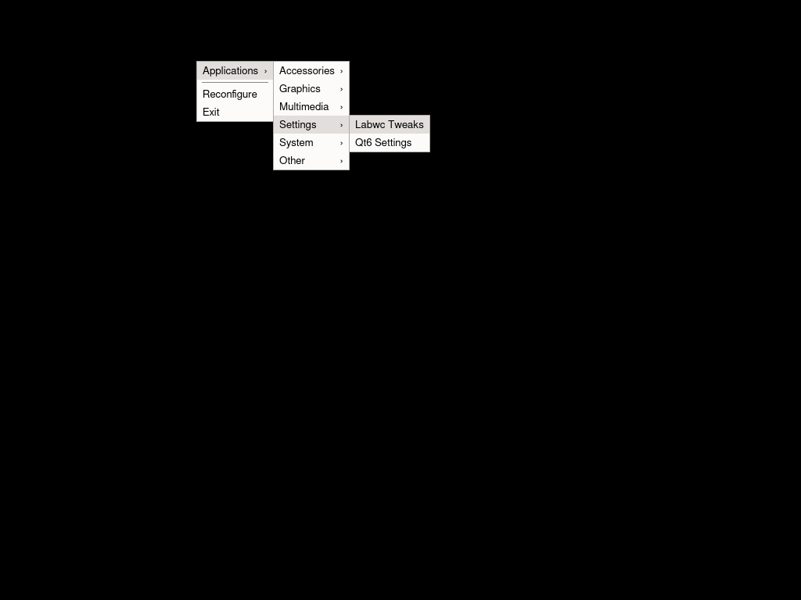
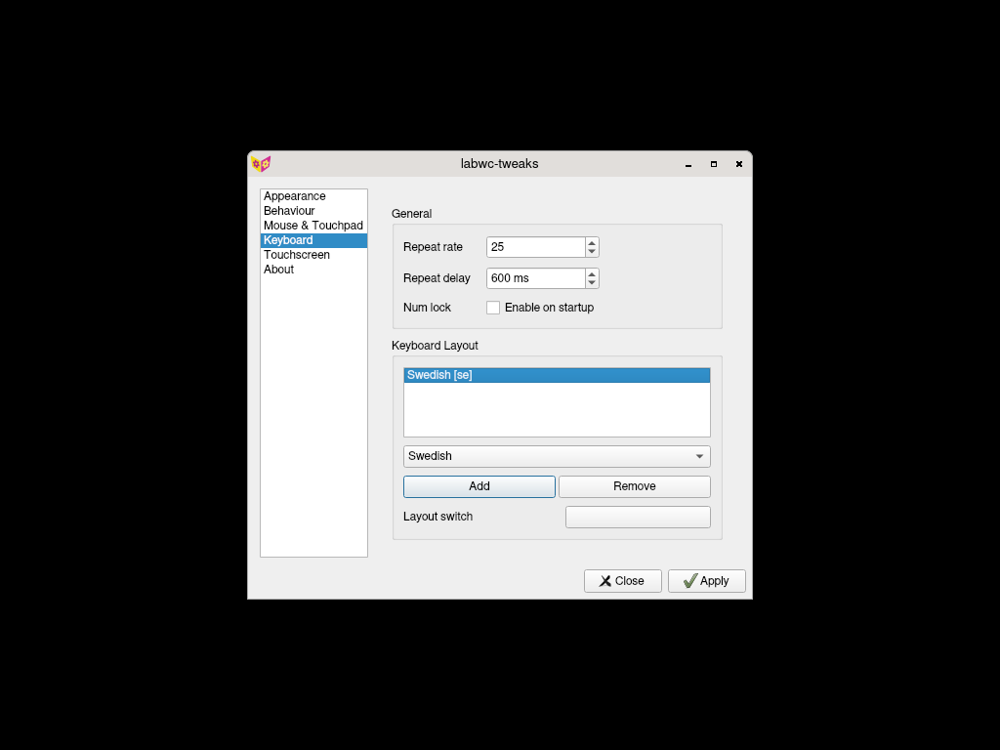

### Themes and fonts

> WARNING: On systems containing already configured Desktop Environments, the
> steps below may cause wider changes.

Linux applications are built using different graphical toolkits. GTK and Qt are
two of the most prominent, and each has its own approach to configuring themes,
fonts and icons. This presents a particular challenge when building a desktop
environment from independent components. Without some coordination,
applications can look quite different from one another, even when they are
running on the same desktop. This will be addressed this by choosing a common
visual direction and configuring both toolkits accordingly.

On a system, such as this, with no configured toolkit or icon theme, clients
using Gtk and Qt look raw and different. The screenshots below show:

- `featherpad` (Qt6)
- `mousepad` (Gtk3)
- `gnome-text-editor` (Gkt4)
- `pcmanfm-qt` (Qt6)
- `thunar` (Gtk3)

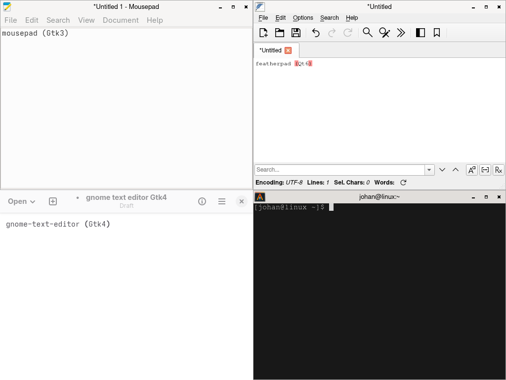
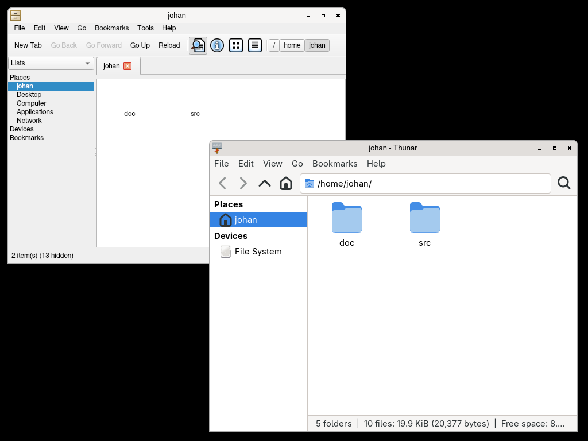

#### Qt Theme

Qt applications use a platform theme integration to determine how they obtain
desktop-wide settings. For this purpose, `qt6ct` will be used in combination
with `kvantum` as the widget style.

Set the Qt theme by taking the following steps:

1. Set `QT_QPA_PLATFORMTHEME=qt6ct` in `~/.config/labwc/environment`.
   `QT_QPA_PLATFORMTHEME` is an environment variable and the labwc environment
   file is a way of making it available to applications launched in the
   compositor.
2. Run `labwc -r` to make the environment variable available to applications.
3. Open `qt6ct` (called "Qt6 Settings" in the root-menu), and choose style
   `kvantum` under the "Appearance" tab.
4. Whilst in `qt6ct`, select `Papirus-Dark` under the "Icon Theme" tab.
5. Also set `DejaVu Sans 10` under the "Font" tab.
6. Open `kvantummanager` and select the `KvGnomeDark` theme.

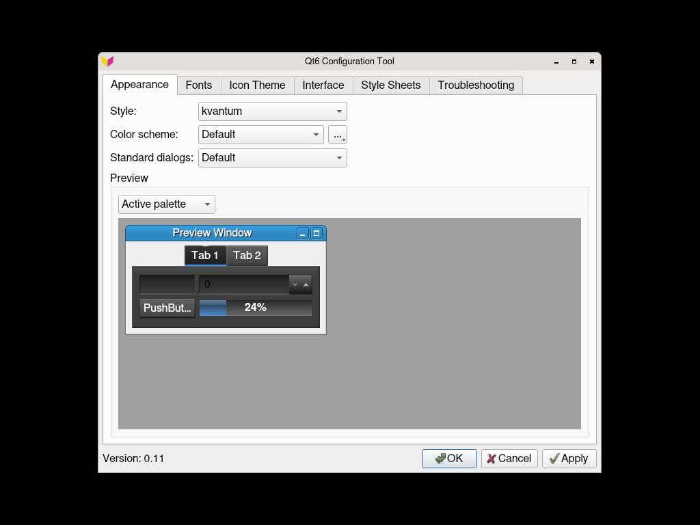
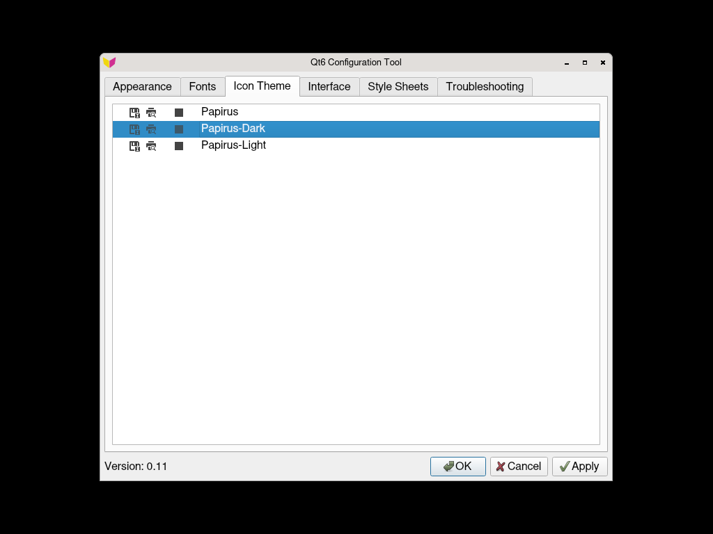
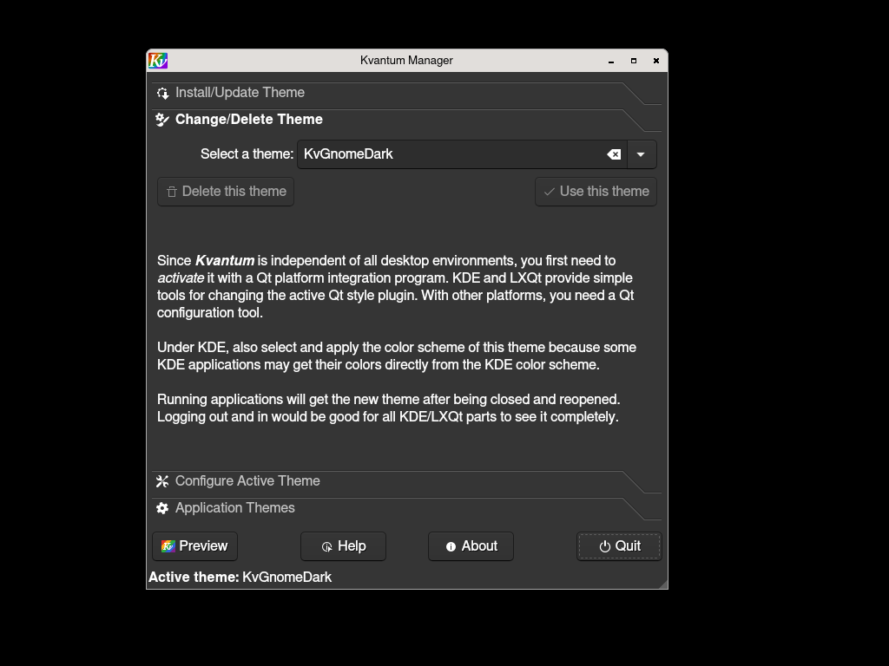

#### Gtk Theme

Setting the Gtk theme and font is simpler. The appearance of GTK applications
can be set using the command `gsettings` without needing a separate GUI
settings application.

Issue these commands:

[desktop-one/bootstrap.sh](desktop-one/bootstrap.sh)

```
gsettings set org.gnome.desktop.interface gtk-theme 'Adwaita-dark'
gsettings set org.gnome.desktop.interface color-scheme 'prefer-dark'
gsettings set org.gnome.desktop.interface icon-theme 'Papirus-Dark'

gsettings set org.gnome.desktop.interface font-name 'DejaVu Sans 10'
gsettings set org.gnome.desktop.interface document-font-name 'DejaVu Serif 10'
gsettings set org.gnome.desktop.interface monospace-font-name 'DejaVu Sans Mono 10'

gsettings set org.gnome.desktop.wm.preferences titlebar-font 'DejaVu Sans 10'
```

#### Compositor Theme

Finally, the compositor (labwc) is configured to use the same visual direction.
This brings the window decorations into line with the applications and gives
the desktop a more coherent appearance.

This can be achieved by manually editing the file `~/.config/labwc/rc.xml` or
smiply use `labwc-tweaks` to set:

- Theme `labTeallach`
- Icon theme `Papirus-Dark`

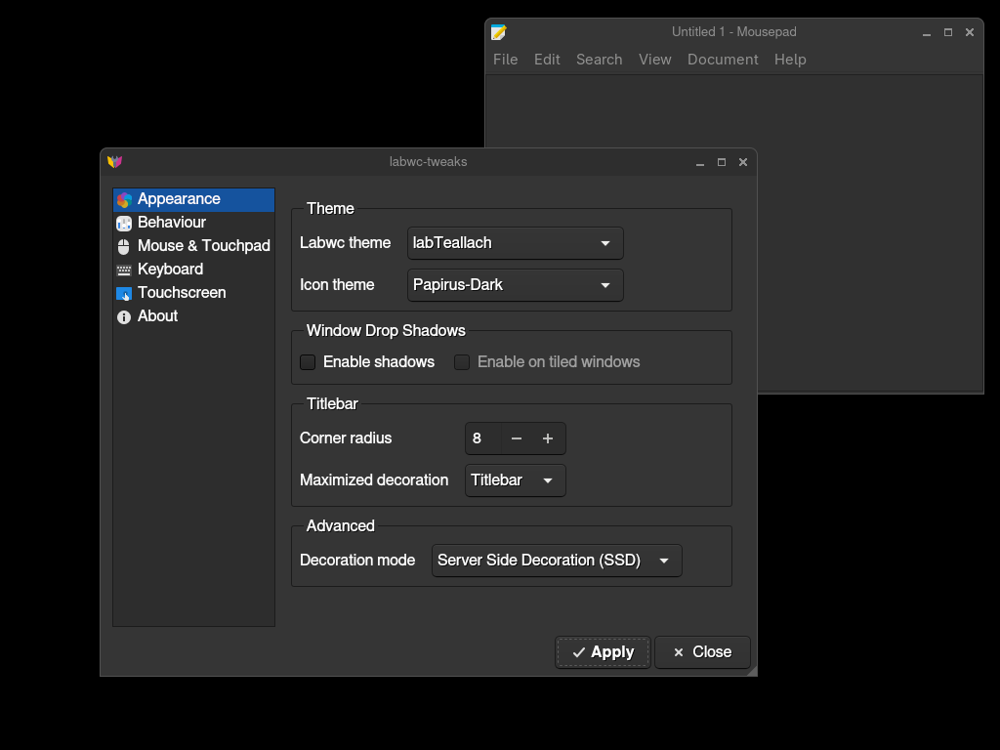

### Panel

At this point, a basic desktop has been established. Applications can be
launched from the root menu, and GTK and Qt applications share a broadly
consistent appearance. However, it is still quite primitive in that there is no
persistent indication of which applications are running and no obvious
indication of the current workspace.

### Wallpaper

## 3.d - Desktop Two

### Palette

Palette based on https://github.com/NLKNguyen/papercolor-theme

/usr/share/foot/themes/paper-color-light


# PART 4 - THE ENGINEERING

In this section, functionality and capability are explored at a deeper level.

